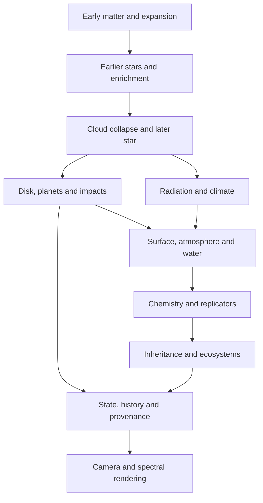

# Cosmic-to-Creature Simulation Blueprint

**Design proposal · 15 November 2026**  
**Scope:** a Rust simulation and interactive 3D observatory tracing matter, energy and history from an early cosmic region to a planet and the organisms that inhabit it.

## 1. What the system is meant to show

A viewer can follow a chain of cause and effect:

1. A simulated mixture of matter evolves under gravity and other physical processes.
2. Earlier generations of stars form, produce elements and return material to their surroundings.
3. An enriched cloud forms a later star and a disk. Material in the disk can accumulate into bodies.
4. The bodies orbit, collide, exchange material and develop planetary surfaces and atmospheres.
5. Light from the star and energy from within a planet drive changing local conditions.
6. A chemistry model explores possible pathways toward self-maintaining, replicating systems.
7. Heritable variation, resource exchange, mortality and reproduction can produce organisms with different bodies and sensory capabilities.
8. A camera samples the simulation at a chosen position and time. The renderer turns the sampled geometry and light transport into an image.

Each step carries forward a record of its inputs, events and uncertainty. A single run may produce a gas giant, a barren world, an ocean planet, a frozen planet or another outcome. A blue planet and a creature with eyes are research targets to investigate across runs. Their appearance depends on initial conditions, modeled processes and evolutionary history.

The current Pelagic website contains a preliminary water-and-sphere physics chamber. This blueprint expands the scope substantially. The earlier creature blueprint remains a useful detailed proposal for local tissue, movement and population mechanics.

### Scientific commitments

- Use named equations, units, measured constants, explicit boundary conditions and conservation checks.
- Track matter and energy between modules. A new model receives a state derived from its parent state and returns changes through a defined interface.
- Distinguish a measured value, an established physical law, an approximate model, a biological hypothesis and a user-selected initial condition.
- Present uncertain outcomes as outcomes of the selected model. Preserve the random seed and full history so experiments can be repeated.
- Keep visible world objects traceable to simulation data. Diagnostic grids, labels and camera controls are identified as observation tools.
- Report accuracy by measured quantity and comparison case. Photorealism is a rendering target assessed against reference data.

## 2. Causal map



The diagram shows dependencies among the models. Impacts affect climate, organisms exchange matter with their surroundings, and atmospheric composition affects the radiation reaching both surface and camera.

## 3. Initial conditions and simulation modes

The laws alone require starting values. Every run begins with a saved manifest containing a physical epoch, domain and boundary conditions, matter distribution, velocities, composition, energy, constants, random seed, model versions and uncertainty ranges.

| Starting point | State supplied at initialization | What the run can trace |
|---|---|---|
| **Primordial research run** | Early-universe conditions, expansion history and primordial composition, with declared density perturbations and a bounded simulation region | Light-element production, later stellar generations, enrichment and subsequent star and planet formation, at the resolution and fidelity of each active model |
| **Enriched-cloud run** | A measured or model-produced interstellar cloud with hydrogen, helium, heavier-element abundances, dust, temperature, density, rotation and velocity fields | Collapse, later-star formation and planetary-system formation. Each supplied element records its prior origin as an input or imported history |
| **Calibrated planetary run** | A documented star, planetary orbit, composition, atmosphere and surface condition | Climate, radiative appearance and local biological experiments while the earlier formation history remains an explicit supplied record |

The primordial route is the full long-term goal. The enriched-cloud and calibrated-planet routes make individual stages testable while upstream modules are being developed. The record must make the chosen entry point visible. Importing a state derived from a scientific model is allowed when its source, version, assumptions and accuracy are attached to it.

### Atoms and element history

A primordial nuclear-reaction network follows the abundance of light nuclei as the early environment cools. Atomic ionization and recombination then determine how much matter is in neutral and ionized form. Later stellar and explosive nucleosynthesis models generate and distribute additional isotopes. The simulation tracks abundances and their origin across star, gas, dust, planet and organism reservoirs.

For an individual oxygen atom in a creature, the practical representation is an abundance and provenance ledger, potentially including contributions from many source events. The simulation represents collections of atoms through abundances while accounting for the transfer of oxygen-bearing material and the uncertainty of its history.

Primordial nucleosynthesis primarily produced hydrogen, helium and small amounts of lithium. Later stars and stellar events contributed heavier elements to the material from which subsequent stars and planets formed. [NASA, First Stars: Composition](https://science.nasa.gov/asset/webb/first-stars-composition/) · [NASA, Are we really made of star stuff?](https://science.nasa.gov/astrobiology/learning-resources/alp/are-we-really-made-of-star-stuff/)

## 4. Engine activation and state handoffs

An **engine** is a versioned numerical model that advances a defined region, entity or process. A supervisor watches simulated state for physically meaningful transitions and activates an appropriate model. Thresholds below are implementation criteria to be calibrated and tested.

| Parent state and trigger | Engine activated | Required input and output |
|---|---|---|
| A gas region becomes gravitationally unstable and contracting | Cloud-collapse solver | Density, temperature, velocity, composition and gravitational field → evolving gas, condensations and heat |
| A bound, dense protostellar region forms | Stellar-interior and disk models | Mass, angular momentum, composition and accretion → stellar structure, luminosity, wind, disk exchange |
| A disk region contains sufficient solid mass and collision activity | Dust/solid growth and orbit models | Particle-size distribution, positions, velocities and composition → growing bodies, fragments and disk depletion |
| A body becomes sufficiently massive and internally hot | Interior, atmosphere and surface models | Mass, spin, energy, volatile inventory and incident radiation → differentiation, outgassing, temperature, surface and atmospheric state |
| A collision trajectory intersects a body | Impact and environmental-response models | Impactor mass, speed, angle, material and target state → deposited energy, ejecta, atmospheric forcing and deposited or escaped matter |
| A local region contains the required reactants and energy sources | Prebiotic-reaction model | Chemical inventory, temperature, pressure, radiation, solvent and surfaces → reaction fluxes and products |
| A defined replicator satisfies an operational persistence criterion | Inheritance and population model | Verified model-specific replicator state, resources and error rates → individual lineages, resource use and offspring |
| Tissue growth and expressed sensitivity exceed the model's resolution criteria | Development and sensing model | Inherited regulatory parameters, local tissue, available energy and incident signals → morphology, sensory response and its biological cost |

For gas, a useful instability indicator compares a region's size with its local Jeans length, `λJ = √(πcs² / (Gρ))`, alongside boundedness, contraction and resolution checks. This is an activation indicator for a particular approximation. Rotation, turbulence, magnetic fields, cooling and boundaries also influence collapse.

For a replicator, the criterion is experimental. One possible test is that it maintains its structure, draws on local resources and produces identifiable copies with heritable variation over a stated number of cycles. The reaction network and conditions that allow this must be recorded as hypotheses supported by experiments or published research.

**Handoff rules**

1. Assign each state a stable ID, parent IDs, simulated time, coordinate frame, units, species inventory, mass, momentum, energy, uncertainty and model version.
2. Split a coarse region into finer regions using conservative remapping. The sum of child mass, elemental inventory, momentum and energy must match the parent within a declared tolerance.
3. A child model exchanges fluxes with its parent. Material cannot be present simultaneously in both inventories.
4. Apply events in a stable order. Save the activation reason, threshold values, seed, solver settings and resulting state hash.
5. Use separate activation and deactivation thresholds or a minimum dwell period to avoid rapid switching near a boundary.
6. On coarsening, aggregate child states and fluxes back into the parent. Keep relevant history, uncertainty and unresolved variation.
7. If a solver fails or a conservation check exceeds its error budget, halt that affected transition and expose the failure. A checkpoint allows a corrected retry.

## 5. Physics and chemistry register

Each implementation entry should name its source, dimensional units, operating regime, numerical method, calibration data, known limitations and tests. The following equations define the initial architecture.

| Layer | Equation or rule | State produced | Model boundaries |
|---|---|---|---|
| Gravity | `aᵢ = G Σⱼ mⱼ(rⱼ−rᵢ)/|rⱼ−rᵢ|³` | Trajectories and gravitational potential | Newtonian gravity for appropriate scales and speeds. Use an N-body solver with close-encounter handling. Cosmological expansion uses its own stated model and coordinates. |
| Gas conservation | `∂ρ/∂t + ∇·(ρu) = 0`, with momentum and energy conservation including pressure, gravity and cooling | Density, velocity, pressure and temperature fields | Equation of state, radiative cooling, turbulence and magnetic treatment require explicit models. |
| Nuclear reactions | `dYᵢ/dt = Σᵣ νᵢᵣ Rᵣ(T,ρ,Y)` | Isotope abundances and reaction energy | Rates and reaction network are sourced scientific inputs. Elemental abundance is conserved across transfers except where nuclear reactions transform it. |
| Star structure | `dm/dr = 4πr²ρ`; `dP/dr = −Gmρ/r²` | Radial mass, pressure, temperature and density | The full model also needs energy generation, transport, accretion and time evolution. A 1D model is an approximation of a star. |
| Stellar light | A first spectral approximation uses Planck's `Bλ(T)`; emitted power follows `L = 4πR²σTeff⁴` | Surface spectrum and luminosity | A blackbody omits spectral lines and detailed atmospheric effects. Later reference spectra and opacity models improve it. |
| Orbital illumination | `S = L/(4πd²)` | Incident stellar flux at distance `d` | Account for occlusion, orbital variation and stellar variability in later builds. |
| Planet thermal budget | `C dT/dt = absorbed stellar power + internal heat − outgoing thermal power + transport` | Temperature history and phase changes | Atmosphere, clouds, ocean and material properties affect the terms. A simple equilibrium check is a baseline. |
| Chemistry | `dcᵢ/dt = Σᵣ νᵢᵣ Rᵣ(c,T,p,light) + transport` | Local reactant and product abundances | Reaction rates, solvent, mineral surfaces and energy sources are specified and tested. The origin of life remains an open research problem. |
| Organism mechanics | `m dv/dt = ΣF`; tissue and fluid models provide contact, elasticity, buoyancy and drag | Movement, strain and energy costs | Tissue geometry and fluid regime determine appropriate coefficients. |
| Population change | Offspring inherit parental variation. A model records survival and realized offspring counts. | Lineages and changed trait distributions | Development, energy, local interactions and chance mediate selection. Body shapes and sensory structures emerge from the inherited development model. |

**Example calibration.** At an Earth-like orbit, use a test star with `Teff = 5,772 K`, `R = 6.957 × 10⁸ m` and orbital distance `1.495978707 × 10¹¹ m`. The equations above give approximately **1,361 W/m²** at that distance. With a fixed albedo of 0.30 and uniform blackbody emission, the equilibrium temperature is approximately **255 K**. This simplified check precedes an atmosphere and greenhouse model. NASA reports a measured solar irradiance near 1,361 W/m², with solar-cycle variation. [NASA GSFC, Solar Irradiance Science](https://earth.gsfc.nasa.gov/climate/projects/solar-irradiance/science)

## 6. From a cloud to a planetary system

### Earlier stars and enrichment

Start with the selected initial mixture and density field. The gas solver follows gravitational collapse, pressure and energy exchange. Bound condensations form stellar candidates. A stellar model follows the mass, composition and evolution of each star and its mass loss. When a modeled stellar event ejects material, record the isotopes, momentum and energy transferred to the surrounding medium.

A later cloud inherits that mixture. This is the material available to form the simulated planetary system. A region's enrichment history is visible in the inspector, including any material supplied by the initial conditions.

### Star and disk

Angular momentum and accretion shape a rotating gas-and-dust distribution around the protostar. The disk model tracks density, temperature, composition, radiation, particle sizes and drag. Grain collision rules account for sticking, fragmentation and rebound using documented collision models. Larger bodies become gravitational particles with finite sizes and composition.

The detailed pathway from dust to planets is active research. The blueprint therefore requires documented approximations and comparison against observations, including disk structures and observed planetary systems. [NASA, Planetary Systems](https://science.nasa.gov/universe/stars/planetary-system/) · [NASA, Origins & Evolution of Planetary Systems](https://www.nasa.gov/core-capability-2-origins-evolution-of-planetary-systems/)

### Planets, dynamics and impacts

Integrate the star, planets and retained smaller bodies under gravity. A collision detector identifies encounters, and impact models account for merging, fragmentation, ejecta and energy where appropriate. Optional external inflow supplies interstellar bodies through a documented boundary distribution. The simulation tags whether a projectile originated within the system or entered through that boundary.

Large planets can alter impact probabilities through gravitational interactions. Compare impact rates across ensembles with different system configurations. Published numerical studies found that a giant planet can either increase or decrease impact rates depending on the body population and configuration. [Horner & Jones, *Jupiter—friend or foe? I: The asteroids*](https://www.cambridge.org/core/journals/international-journal-of-astrobiology/article/abs/jupiter-friend-or-foe-i-the-asteroids/239A8776866B612FD2BF39596F1A321B)

Impact energy starts with `E = ½mv²` at the relevant encounter point. An impact model distributes the deposited and escaped portions among target, ejecta, atmospheric dust and heat. Its climate response modifies light, temperature and resources over time. The ecosystem then responds through mortality, reproduction, movement and changing food availability. A species may decline, persist or expand as a consequence of these modeled interactions.

## 7. From planet to a living environment

### Planetary surface and climate

The planet carries a material inventory, internal heat, rotation, gravity and topography or a lower-resolution surface representation. The climate model receives time-varying stellar radiation, orbital geometry and atmospheric composition. It updates local energy, pressure, phase changes and transport. Evaporation, condensation, atmospheric escape, volcanism and water transport are introduced as explicit processes with their own inventories.

Habitability is a set of computed conditions over space and time. Track liquid-solvent availability, energy sources, temperature, pressure, radiation, chemistry and disturbance history. Store both the mean conditions and their variability. A local organism samples its actual patch of the environment.

### Chemistry and the origin of life

Begin with a specified reaction network and environmental setting, such as a mineral surface or a water-filled pore. Reactions move material among named species and consume or release energy. The model can compare multiple proposed networks with different rate uncertainties. Measured chemical kinetics and experiments anchor their inputs.

The transition to self-maintaining replicators is a research hypothesis and a separate validation milestone. NASA notes that major questions remain about the order and origin of the reactions involved. If a run begins with an introduced replicator to test evolution, label the introduction, composition and timing in its history. [NASA Astrobiology, *No Catalyst? No Problem.*](https://astrobiology.nasa.gov/news/no-catalyst-no-problem/)

### Organisms and transactions

Each organism draws matter and usable energy from its surroundings and returns heat and waste. Growth, maintenance, movement, repair, defense and reproduction have costs. The environment is affected by consumption, waste and death. Predation transfers a fraction of a prey's stored material and energy to a predator. All exchanges appear in the ledger.

A genome supplies heritable parameters for development and physiology. Local signaling, cell growth, mechanics and environmental conditions produce the body. Reproduction and mutations produce new combinations of inherited parameters. The population's trait frequencies can change when traits affect survival or reproduction in the simulated environment. Random events and changing conditions also affect outcomes.

### A route to sensory organs

A light-sensitive component can arise in a modeled lineage if the encoded chemistry supports it. Incident photons and a wavelength-dependent absorption model yield a noisy signal. Pigment, body geometry and tissue arrangement may change how directional the signal is. A controller may use that signal to seek resources or avoid a modeled hazard. The organism pays the material and energy costs of producing and maintaining the tissues.

Compare related populations over generations. Record changes in survival, offspring counts, energy cost, sensitivity and directionality. A complex sensory organ is an observed result only when its tissues, signal processing and useful function are present in the state and supported by the model. A detailed review connects inherited developmental variation, sensing, behavior and fitness in eye evolution. [Nilsson, *Eye evolution and its functional basis*](https://pmc.ncbi.nlm.nih.gov/articles/PMC3632888/)

## 8. Data to image

### Camera contract

The camera asks the simulation for a region, time, position, orientation, field of view and quality level. It receives a snapshot containing object IDs, surfaces or fields, material properties, light sources and provenance references. The simulation's state and time evolution are independent of camera position. Camera choices affect projection, occlusion and the resolution of the retrieved representation.

Use world-scale, double-precision coordinates for physical state and a camera-relative coordinate system for rendering. A body-fixed coordinate frame lets the view move from orbit to a local site without losing the link to the planet. Where light-travel delay matters, use emission-time samples. A same-time approximation is labeled in the view settings.

A mesh vertex or volume sample includes a reference to the body, tissue or field from which it was derived. A probe can report the source state, time, material, units and model. Geometry detail may be reconstructed from a conserved model representation when the added detail has a documented physical basis and deterministic parameters. Unresolved regions display their resolution or uncertainty.

### Light transport

For wavelength `λ`, the renderer solves or approximates the radiative transfer equation along a viewing ray:

```text
dIλ/ds = −(κa,λ + κs,λ) Iλ + jλ
         + κs,λ ∫ pλ(Ω′ → Ω) Iλ(Ω′) dΩ′
```

Here `Iλ` is spectral radiance, `κa` absorption, `κs` scattering, `jλ` local emission, and `pλ` the scattering phase function. Their units, material sources and approximations belong to the model record. A spectral surface model supplies reflection, transmission and emission. The renderer integrates radiance against standard observer color-matching functions, converts to display color and applies documented exposure and tone mapping.

For a clear Earth-like atmosphere, molecular Rayleigh scattering redistributes short wavelengths more strongly and contributes to the blue sky. Gases also absorb at particular wavelengths. Aerosols, water droplets, cloud cover, surface reflectance, the star's spectrum and the path to the camera all affect the final image. Blue ocean color and a blue atmospheric limb have different contributing processes and should be tested independently. [NASA Planetary Spectrum Generator, atmospheric scattering](https://psg.gsfc.nasa.gov/helpatm.php)

The star's core supplies nuclear energy to its interior. The emitted spectrum is determined by energy transport and conditions in its photosphere and atmosphere. The initial blackbody approximation uses the modeled effective temperature and radius. Improved stellar spectra can then be compared with measured data.

### Traceability examples

| Visible result | State and equations used | Inspectable evidence |
|---|---|---|
| Planet position | N-body state, chosen time and camera frame | Body ID, coordinates, velocity, integrator and last checkpoint |
| Atmospheric limb | Gas composition and density, incoming stellar spectrum, scattering and absorption | Spectral optical depth by species and path |
| Cloud highlight and shadow | Cloud water/ice distribution, droplet model, star direction and multiple scattering approximation | Local cloud state, optical depth, light path and rendering mode |
| Surface ocean | Water distribution, surface geometry, absorption, scattering and reflection | Water depth, material parameters, incident and reflected spectrum |
| Creature eye or light-sensitive tissue | Inherited development, tissue and pigment state, incident light and modeled sensory response | Ancestry, tissue contributors, photon response, energy cost and behavioral effect |
| Crater and climate change | Recorded collision, impact energy, target and ejecta models, later weather history | Projectile origin, trajectory, energy budget, event time and response-model version |

## 9. Runtime architecture

### Simulation core

- **Rust core** owns the authoritative state, model registry, conserved ledgers, event queue, scheduling, seeded random streams, snapshots and provenance.
- **Model modules** implement bounded interfaces for gravity, gas, stellar evolution, chemistry, climate, mechanics and evolution. Each declares validity ranges and numerical controls.
- **Supervisor** activates modules from state transitions and manages conservative exchange. An engine's physical state continues to evolve whether the camera is nearby or far away.
- **Storage** records a run manifest, initial conditions, checkpoints, commands, data versions, event log and hashes. Scientific inputs such as opacities and reaction rates carry their source and license.
- **Reproducibility** uses independent named random streams derived from the run seed and entity IDs. A same-build replay should match its state hashes. Cross-platform comparisons use documented floating-point tolerances unless bitwise identity is demonstrated.

### Example state and exchange contract

A solver receives and returns a versioned record with explicit units. For example, a cloud cell passed to a collapse model carries:

```text
entity_id, parent_region_id, epoch_seconds
frame, position_m, velocity_m_per_s, cell_volume_m3
mass_kg, temperature_K, internal_energy_J
composition: isotope_id → mass_kg
angular_momentum_kg_m2_per_s
model_version, timestep_s, source_refs, uncertainty
```

If a star forms inside that cell, the event removes its initial mass and isotope inventory from the gas and places them in the stellar state. The event records accretion and radiated or ejected energy separately. A reconciliation check compares all reservoirs before and after the transition. The same convention applies when disk material forms a planet, an impact transfers ejecta or an organism consumes food.

A run manifest defines whether a module operates as a resolved solver, a calibrated approximation or a supplied initial state. Each approximation declares its range of validity and what observations were used to calibrate it. The interface displays this provenance when the corresponding state is inspected.

### Time and scale

The system spans orbital years, stellar lifetimes, atmospheric days, chemical reactions and biological generations. A single global fixed step cannot efficiently resolve all of them.

- Advance each solver with a timestep justified by its dynamics and numerical stability.
- Exchange boundary fluxes at synchronized times. Coupled models must account for energy and material changes across those intervals.
- Use adaptive resolution and validated reduced models for slow background processes. Track what has been approximated and the error bounds.
- Store checkpoints at transitions and when the user branches an experiment. A jump in time evaluates or integrates the relevant models over the interval using their selected methods.
- Report simulated time, wall time, active models and accuracy settings. A visual fast-forward is tied to actual model advancement.

### Website and computation

The site presents a 3D viewport, an object/field inspector, a timeline, model controls, and a lineage explorer. Users can pause, step, compare runs, branch from a checkpoint and inspect each visible feature's history. A quality panel shows the current physical resolution and rendering approximations.

A browser Web Worker can run smaller Rust-to-WebAssembly experiments. Larger simulations can run in a native Rust process or a compute service that publishes snapshots to the same viewer. The interface and file format should work with both. The core scientific run must not depend on graphics frame rate or camera movement.

Use existing scientific implementations as independent references where practical. REBOUND provides established gravitational N-body integrators, and MESA provides a 1D stellar-evolution reference. Treat cross-comparison, data exchange and licensing as explicit engineering work. [REBOUND](https://github.com/hannorein/rebound) · [MESA documentation](https://docs.mesastar.org/en/24.08.1/)

## 10. Build and verification sequence

Each gate creates an inspectable experiment with recorded data. Numerical tolerances below are proposed engineering targets to finalize after reference models and numerical methods are selected.

| Gate | Build | Acceptance evidence |
|---|---|---|
| **0. Model foundation** | Standard Rust toolchain, deterministic event log, units, state ledger, checkpoint and replay | Same-build replay matches hashes for fixed seed and commands. Failed transfers are detected. Browser view and native runner read the same recorded state. |
| **1. Orbits and light** | A star and planet with gravity, orbital motion, luminosity and camera | Circular two-body orbit follows the analytic solution. Report energy and angular-momentum drift as timestep is reduced. Reproduce the 1,361 W/m² irradiance fixture. |
| **2. Atmosphere and camera** | Layered air, gas absorption, Rayleigh scattering, ground and orbital views | Verify zero optical depth, Beer–Lambert attenuation and wavelength dependence. Compare sky and limb radiance against a documented radiative-transfer reference under matched inputs. |
| **3. Impacts and planetary history** | Small-body populations, collision detection, parameterized impact and climate response | Momentum and material ledgers close within specified tolerance. Repeat giant-planet configurations across seeds and report impact distributions and uncertainty. |
| **4. Formation and enrichment** | Gas collapse, disk evolution, solid growth and isotope provenance | Controlled tests for mass, momentum and energy conservation. Compare orbital results with REBOUND and stellar output with published reference models over declared regimes. |
| **5. Planetary environment and chemistry** | Atmosphere, water, surface energy and a chosen sourced reaction network | Check elemental and energy conservation. Reproduce published or experimentally measured reaction and transport cases with uncertainty ranges. |
| **6. Replicators and organisms** | Documented replicator model, resource exchange, inheritance and developing tissue | Reproduction transmits defined inherited state. Divisions conserve material. Growth stops when available energy is exhausted. Every visible tissue maps to simulated state. |
| **7. Sensory evolution** | Light absorption, sensory signal, behavior, tissue cost and populations | Compare multiple seeded populations and controls. Show changes in actual reproductive success and sensory function, with confidence intervals and extinction counts. |
| **8. Integrated observatory** | Link modules through shared state and events, view from space to a local organism | Trace a visible pixel or surface through material, light and history. Camera movement leaves physical state unchanged. Run paired experiments from a common checkpoint. |

Gate order supports early validation of the camera and physical models while upstream formation and downstream biology are developed. Validate the connections across gates as well as each individual model.

## 11. Experiments that connect the scales

### A. Does the atmosphere render correctly?

Use a known Earth-like reference state with specified solar spectrum, atmospheric profiles, clouds and surface. Compute sky radiance at selected wavelengths and viewing angles, then compare it with an independent radiative-transfer calculation. Change nitrogen/oxygen density, aerosols and cloud optical depth one at a time. Record spectral error, color conversion and exposure. This measures the rendering and atmosphere model under known inputs.

### B. What does a giant planet do to impact rates?

Clone a saved system and vary a giant planet's mass or orbit while holding the other documented inputs fixed. Run a population of minor bodies across multiple seeds. Compare impact frequency, projectile origin, energy distribution and uncertainty over the same period. Feed recorded impact events into the planet and ecosystem models when those models reach their validation gates.

### C. Can a sensory structure become advantageous?

Start two populations from the same ancestral state in matched habitats. Introduce a modeled light-dependent food or hazard gradient in one habitat. Run many seeds. Record inherited receptor traits, actual sensor response, behavior, costs and reproductive success. Raise descendants in the same common environment to separate inherited differences from immediate environmental responses.

### D. Trace one visible feature backwards

Select a patch of tissue on a creature. The inspector shows its current material and cell ancestry, the organism's parentage, the environmental resources used in growth, the local planet's inventory and any known stellar enrichment sources for those materials. Each connection shows its resolution, uncertainty and source. The chain ends at the selected run's actual initial conditions.

## 12. Evidence, limitations and review

| Question | How to assess it |
|---|---|
| Are the equations implemented correctly? | Analytical fixtures, dimensional checks, conservation residuals, timestep convergence and independent reference solvers. |
| Are the inputs representative? | Compare abundances, stellar spectra, orbital elements, atmospheric profiles and reaction rates with named observations or experiments. |
| Is the outcome robust? | Repeat across seeds, resolutions, parameter ranges and alternative published models. Report distributions. |
| Is a visual detail supported? | Follow its geometry, material and lighting through the state inspector. Show uncertainty and approximation level. |
| Does the model establish a real origin of life? | Compare proposed chemical pathways with experimental evidence and publish competing hypotheses. A simulation result tests a specified model. |
| Does it reproduce Earth? | Compare many independent observables, including orbital and planetary properties, spectra, atmospheric profiles and geological history. An Earth-like appearance alone is insufficient. |

The complete project is a multi-scale research program. A simulation can use well-tested physical laws while still depending on uncertain initial conditions, incomplete chemical pathways and approximate models. The blueprint makes those assumptions visible so the generated world can be explored and challenged.

## References

1. NASA, [First Stars: Composition](https://science.nasa.gov/asset/webb/first-stars-composition/).
2. NASA, [Are we really made of star stuff?](https://science.nasa.gov/astrobiology/learning-resources/alp/are-we-really-made-of-star-stuff/).
3. NASA, [Planetary Systems](https://science.nasa.gov/universe/stars/planetary-system/) and [Origins & Evolution of Planetary Systems](https://www.nasa.gov/core-capability-2-origins-evolution-of-planetary-systems/).
4. Horner & Jones, [Jupiter—friend or foe? I: The asteroids](https://www.cambridge.org/core/journals/international-journal-of-astrobiology/article/abs/jupiter-friend-or-foe-i-the-asteroids/239A8776866B612FD2BF39596F1A321B).
5. NASA GSFC, [Solar Irradiance Science](https://earth.gsfc.nasa.gov/climate/projects/solar-irradiance/science) and [Planetary Spectrum Generator atmospheric-scattering documentation](https://psg.gsfc.nasa.gov/helpatm.php).
6. NASA Astrobiology, [No Catalyst? No Problem.](https://astrobiology.nasa.gov/news/no-catalyst-no-problem/).
7. Nilsson, [Eye evolution and its functional basis](https://pmc.ncbi.nlm.nih.gov/articles/PMC3632888/).
8. [REBOUND](https://github.com/hannorein/rebound) and [MESA documentation](https://docs.mesastar.org/en/24.08.1/).
